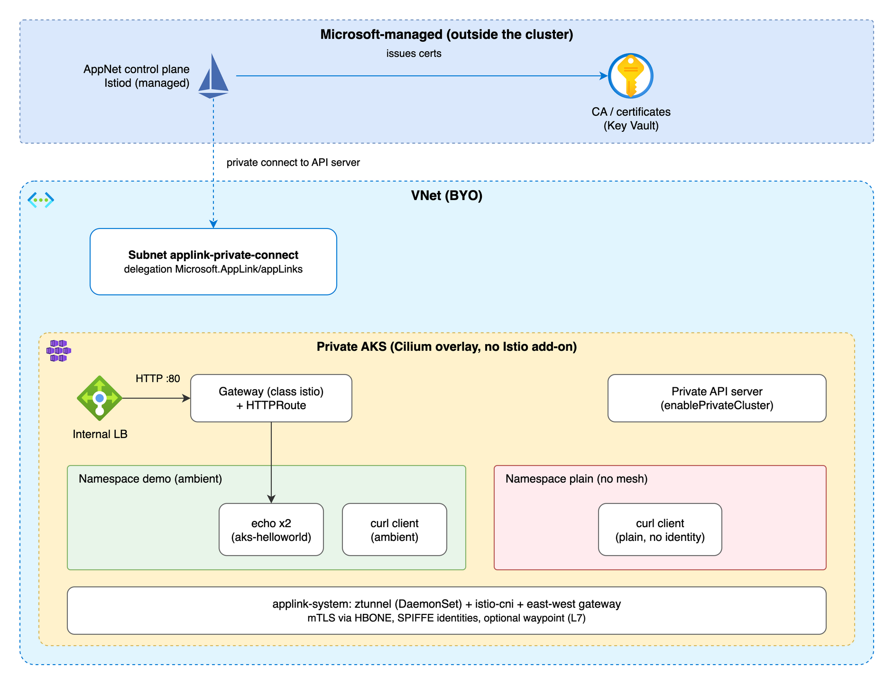

# AppNet private cluster demo

IaC test for the **Azure Kubernetes Application Network (AppNet) preview** on a **private AKS cluster** with an **internal Istio (Gateway API) gateway**. Blog post: [AKS Application Network (AppNet) on a Private Cluster](https://jonas.garden/posts/appnet-private-cluster/)



> Public preview. Status: **tested end-to-end on 2026-11-17** (swedencentral, AKS default version, AppNet 1.5, SelfManaged).

## What it builds

- VNet with a node subnet and a dedicated `/27` subnet for `Microsoft.AppLink/appLinks` (private-connect path)
- Private, regular AKS (1 node, Azure CNI overlay + Cilium, Free tier, Entra + OIDC, managed Gateway API, no Istio add-on)
- AppNet resource and the private-connect member (all as code)
- Network Contributor for the cluster identity on the VNet (needed for the internal load balancer in a BYO VNet)
- Sample app in an ambient namespace plus an internal `Gateway` and `HTTPRoute`

Regular AKS only: AKS Automatic currently fails the member join ([Azure/AKS#6055](https://github.com/Azure/AKS/issues/6055)).

## Prerequisites

- Region: swedencentral or northeurope (not westeurope/germanywestcentral/francecentral/uksouth)
- `az extension add --name appnet-preview --upgrade` (>= 1.0.0b2), Azure CLI >= 2.84
- Features registered on the subscription: `Microsoft.AppLink/PublicPreview` and `PrivatePath`, then `az provider register -n Microsoft.AppLink`
- PrivatePath registration was enough for a personal subscription; no extra service enablement was needed
- vCPU quota for the node SKU (new subscriptions: check `Standard_D2ads_v7`, not B-series or Dv5)

## Run

```bash
cp example.tfvars my.tfvars   # edit
cd infra && tofu init && tofu apply -var-file=../my.tfvars
```

The member is created by OpenTofu (`azapi_resource.member`), so there is no `az appnet member join` step. The private-connect subnet is an `azapi_resource` that sets the `Microsoft.AppLink/appLinks` delegation, because `azurerm_subnet` rejects that name ([azurerm#33877](https://github.com/hashicorp/terraform-provider-azurerm/issues/33877)). There are no `azurerm` resources for AppNet yet ([azurerm#33878](https://github.com/hashicorp/terraform-provider-azurerm/issues/33878)).

The cluster uses Entra integration with Azure RBAC. To run kubectl, give your user the `Azure Kubernetes Service RBAC Cluster Admin` role on the cluster first:

```bash
az role assignment create --assignee <your-object-id> --role "Azure Kubernetes Service RBAC Cluster Admin" --scope <aks_id>
```

The cluster is private, so run kubectl through `az aks command invoke`:

```bash
az aks command invoke -g <aks_rg> -n <aks_name> --command "kubectl get pods -A" 
az aks command invoke -g <aks_rg> -n <aks_name> --file manifests/00-app.yaml --command "kubectl apply -f 00-app.yaml"
az aks command invoke -g <aks_rg> -n <aks_name> --file manifests/10-gateway-internal.yaml --command "kubectl apply -f 10-gateway-internal.yaml"
az aks command invoke -g <aks_rg> -n <aks_name> --command "kubectl get gateway,svc -n demo"
```

## Results

1. Member reaches `Succeeded` (about 10 minutes); `applink-system` runs `istio-cni-node`, `ztunnel` and `istio-eastwestgateway`; GatewayClasses `istio`, `istio-waypoint`, `istio-east-west`, `istio-remote` exist
2. Namespace label `istio.io/dataplane-mode=ambient` works; ztunnel logs show the `demo` workloads
3. `service.beta.kubernetes.io/azure-load-balancer-internal: "true"` on the Gateway is copied to the generated Service; Gateway gets an internal IP (10.20.0.7) and `Programmed=True`
4. `curl http://<gateway-ip>/` from a pod returns 200 via `server: istio-envoy`
5. mTLS via ztunnel: an ambient client reaches the pod through HBONE (`dst.addr` port 15008) with SPIFFE identities on both ends; a client from an unlabeled namespace connects in plaintext on port 80 without identity, and without policy that is allowed
6. L4 `AuthorizationPolicy` (30-authz-l4.yaml): after applying it, the plaintext client is rejected at ztunnel (curl returns 000), the ambient client still gets 200
7. Waypoint (40-waypoint.yaml, `istio-waypoint` GatewayClass plus `istio.io/use-waypoint` label on the Service): L7 policy is enforced by the waypoint, `GET /` returns 200, `GET /admin` returns 403 `RBAC: access denied` from `istio-envoy`
8. Gotchas: member names need 3-24 chars; the internal LB takes 10-20 minutes to appear after the role assignment (`LinkedAuthorizationFailed` on `subnets/join/action` until it propagates); `azurerm_subnet` rejects the AppLink delegation name (use AzAPI, see above); an L7-only DENY rule without a port triggers a warning (it would deny all TCP on the waypoint)

## Clean up

Remove the member before the AppNet resource (`tofu destroy` handles the order).
